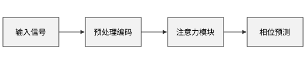
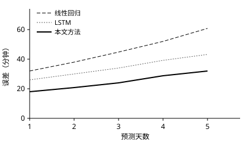

# Introduction {#sec:intro}

The timing of sleep drifts with the seasons, with travel and with work schedules. When the drift is large it affects attention, mood and metabolism, so an early warning would let people adjust light exposure or routines before the shift happens. Laboratory measurements such as dim-light melatonin onset are accurate but expensive, and they cannot be repeated every day.

Wrist-worn devices record heart rate, movement and skin temperature continuously and cheaply. The signals are noisy, differ from person to person, and often have gaps, which makes direct estimation of the circadian phase difficult[^data]. This article asks a narrower question: given the last two weeks of data, how well can the phase shift over the next few days be predicted?

[^data]: A typical device loses between 5 % and 15 % of the samples each night, mostly when the strap is loose.

Our contributions are:

- a simple model that encodes each signal separately and combines them with attention ([@sec:method]);
- an evaluation on simulated recordings with horizons from one to five days ([@sec:results]);
- a look at the attention weights, which indicate which signal matters for each person.

# Method {#sec:method}

## Overview

[@fig:framework] shows the structure. Each raw signal is resampled to one value per minute, normalized per person, and passed through its own encoder. An attention layer weighs the encoded signals and a small output layer predicts the phase shift in minutes.

{#fig:framework width=85%}

## Attention over signals

Let $h_1, \dots, h_S$ be the encoded signals. The model computes a weight for each signal and a weighted sum,

$$
\alpha_s = \frac{\exp(w^\top \tanh(W h_s))}{\sum_{k=1}^{S} \exp(w^\top \tanh(W h_k))}, \qquad z = \sum_{s=1}^{S} \alpha_s h_s ,
$$ {#eq:attention}

and the prediction is $\hat{y} = v^\top z + b$. The weights $\alpha_s$ in [@eq:attention] are what we inspect in [@sec:results].

## Training

The model is trained with the mean absolute error, because a few nights with very late sleep should not dominate the loss. The core of the training step is short:

```python title="train.py" {#lst:train}
for signals, target in loader:
    prediction = model(signals)
    loss = (prediction - target).abs().mean()
    optimizer.zero_grad()
    loss.backward()
    optimizer.step()
```

# Results {#sec:results}

[@tbl:result] compares the model with two baselines for a three-day horizon. The attention model has the lowest error and the smallest spread across people.

: Mean absolute error for a three-day horizon (minutes) {#tbl:result}

| Method | Mean | Std. dev. | Worst person |
| --- | --- | --- | --- |
| Linear regression | 41.3 | 12.8 | 77.0 |
| LSTM | 27.6 | 9.4 | 55.2 |
| Attention (ours) | **18.9** | **6.1** | **39.5** |

[@fig:error] shows how the error grows with the horizon. All methods degrade, but the gap between the attention model and the baselines stays roughly constant.

{#fig:error width=75%}

For most simulated people the attention weight on skin temperature is the largest, which agrees with the known link between distal skin temperature and sleep onset. As one reviewer of an earlier draft put it:

> The interesting part is not that the error is small, but that the model tells you which signal it trusted.

# Conclusion {#sec:conclusion}

A small attention model predicts the shift of sleep phase a few days ahead from ordinary wearable data, at least on simulated recordings. The next steps are a test on real data and a study of how many nights of history are really needed.

# References

1. A. Author and B. Author, "A placeholder reference," *Journal of Examples*, vol. 1, pp. 1–10, 2026.
2. C. Author, *A Placeholder Book*. Example Press, 2025.
