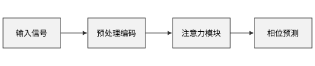
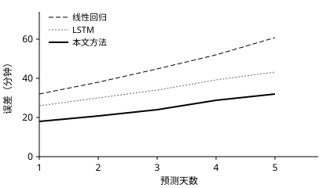
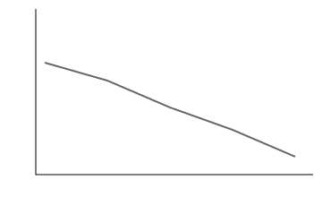
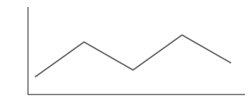

这份文件用来检查边界情况：没有题目，没有一级标题之前的内容也不应该出错。这张图在第一个标题之前，没有章号：

{#fig:before}

# 第一章

## 跳过的情况

#### 跳过第三级，直接写第四级

下面是粘贴图片的常见写法，没有说明，所以不编号，也不占图号：



有说明但没有标签的图片，也会编号：


和文字写在同一段里的图片不算独立的图  这里还有文字。

写错的引用会标红：[@fig:not-exist]，[@tbl:not-exist]。

代码里的引用和标记不处理：`[@fig:before]`，以及下面的代码块：

```markdown
$$ x = 1 $$ {#eq:in-code}
{#fig:in-code}
[@fig:before]
```

引用前面的图：[@fig:before]。引用后面的图：[@fig:later]。引用下一章：[@sec:second]。

没有表题的表格也用三线表，不编号：

| A | B |
| --- | --- |
| 1 | 2 |

这段以冒号开头，但是旁边没有表格，所以只是普通文字：

: 普通文字，不是表题

# 第二章 {#sec:second}

换了一章，图号重新开始：

{#fig:later}

一行写完的公式：

$$ a^2 + b^2 = c^2 $$ {#eq:one-line}

没有标签的公式：

$$ E = mc^2 $$

不编号的公式：

$$ 1 + 1 = 2 $$ {-}

引用：[@eq:one-line]。

图组的边界情况。没写 cols 时默认两列，没有总标题时只显示图号：

::: figures



:::

子图没写说明时，只显示字母。引用写错的子图会标红：[@fig:no-such-panel]

::: figures {cols=2}


只有总标题
:::

cols 超出范围时按最多 6 列处理：

::: figures {cols=99}


七张图
:::

图组里不该有的内容不会丢，会放在图组后面：

::: figures


- 这个列表不是图

总标题
:::

图片大小的边界情况，下面依次是 30%、5cm、写错的宽度（按原大小）、写在标签前面：

{#fig:w-percent width=30%}

{width=5cm}

{width=abc}

{width=40% #fig:w-order}

引用：[@fig:w-percent]、[@fig:w-order]。没有说明的图也能调大小，并且不编号：

{width=25%}

不认识的属性不算图片属性，会原样显示：

{height=3cm}

下面是分页符。行内的 \newpage 不分页，代码里的也不分页：`\newpage`

\newpage

```
\newpage
```

代码块的边界情况。只写语言不编号：

```python
print("没有编号")
```

只有 title，文件名里的符号不当格式，HTML 也不会生效：

```python title="a_b_c*d*<b>e</b>.py"
print("代码 2-1")
```

title 可以有空格，也可以用单引号，没写语言也行：

``` title='注意力 计算'
没有语言
```

只有标签没有 title，也会编号，这样才能被引用：[@lst:only-label]。写错的引用会标红：[@lst:no-such]

```python {#lst:only-label}
print("只有标签")
```

属性顺序可以调换，不认识的语言也不报错：

```no-such-language {#lst:reorder} title="顺序调换.txt"
some text
```

列表里的代码块：

- 第一项

  ```python title="in-list.py"
  print("在列表里")
  ```

下面这个代码块里的内容不是真的标题，要原样显示：

````markdown
```python title="a.py" {#lst:in-code}
print("这是示例")
```
````

# 不编号的章 {-}

## 这一节也不编号

不编号的章里的图继续用上一章的图号：


# Appendix Notes

名字以 Appendix 开头但不是附录，比如这个标题，按普通章节编号。

# 附录

## 附录里的小节

# 附录 C：写了字母也按实际顺序编号

字母由顺序决定，这一个是第二个附录，所以是 B。

# 第三章

回到普通章节后，章号接着前面的普通章节，不受附录影响。

{width=30%}

这一章的编号应该是 3，因为上面那章不占编号。

- 列表第一项[^n]
- 列表第二项

[^n]: 列表里的脚注。
