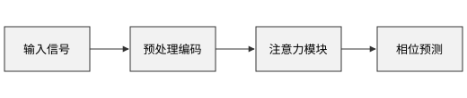
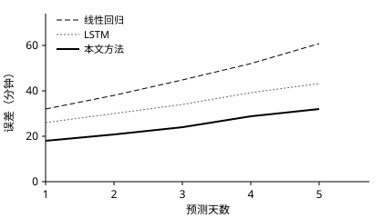
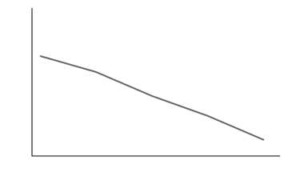
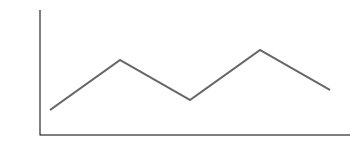

# 引言 {#sec:intro}

睡眠节律是人体最重要的生理节律之一。节律紊乱会影响认知能力、情绪和代谢健康[^1]。随着可穿戴设备的普及，连续采集心率、活动量和皮肤温度已经成为可能，这为个体化的节律预测提供了数据基础。Recent wearable devices make long-term monitoring practical, and English words should use a Latin serif font.

本文的主要工作如下：[@sec:method]介绍预测模型，[@sec:experiment]给出实验结果，[@sec:conclusion]总结全文。其中整体框架见[@fig:framework]，核心公式见[@eq:attention]，实验结果见[@tbl:result]。

[^1]: 这是一条脚注，用来测试脚注的字号和位置。

## 研究背景

传统的节律评估依赖实验室内的褪黑素检测，成本高，也难以长期进行。基于可穿戴设备的方法成本较低，但数据噪声大，个体差异明显。

## 本文贡献

本文的贡献主要有三点：

1. 提出一种融合多通道生理信号的注意力模型；
2. 设计了针对缺失数据的掩码机制；
3. 在模拟数据集上验证了方法的有效性。

# 预测方法 {#sec:method}

## 整体框架

模型的整体框架如[@fig:framework]所示。输入数据先经过预处理和编码，再由注意力模块提取特征，最后输出未来一周的相位预测。

{#fig:framework}

## 注意力模块

给定查询 $Q$、键 $K$ 和值 $V$，缩放点积注意力的计算方式见[@eq:attention]：

$$
\mathrm{Attention}(Q, K, V) = \mathrm{softmax}\left(\frac{QK^{\top}}{\sqrt{d_k}}\right) V
$$ {#eq:attention}

其中 $d_k$ 是键向量的维度。模型的损失函数定义为：

$$
\mathcal{L} = \frac{1}{N} \sum_{i=1}^{N} \left| \hat{y}_i - y_i \right| + \lambda \left\| \theta \right\|_2^2
$$ {#eq:loss}

为了简化推导，这里有一个不需要编号的中间步骤：

$$
\hat{y} = g(x; \theta)
$$ {-}

### 缺失数据处理

可穿戴设备的数据经常有缺失。本文使用掩码矩阵标记缺失位置，并在计算[@eq:attention]时屏蔽这些位置。

### 实现细节

核心代码见[@lst:attention]：

```python title="model/attention.py" {#lst:attention}
def attention(q, k, v, mask=None):
    score = q @ k.transpose(-2, -1) / k.size(-1) ** 0.5
    if mask is not None:
        score = score.masked_fill(mask == 0, -1e9)
    return score.softmax(dim=-1) @ v
```

下一章从新的一页开始：

\newpage

# 实验结果 {#sec:experiment}

## 数据集

实验使用的模拟数据集信息见[@tbl:dataset]。

: 数据集信息 {#tbl:dataset}

| 数据集 | 受试者数量 | 采样频率 | 持续时间 |
| --- | --- | --- | --- |
| 训练集 | 120 | 1 Hz | 90 天 |
| 验证集 | 30 | 1 Hz | 90 天 |
| 测试集 | 50 | 1 Hz | 30 天 |

## 对比实验

各方法的预测误差见[@tbl:result]，误差曲线见[@fig:error]。可以看到，本文方法的误差最低。

| 方法 | MAE（分钟） | RMSE（分钟） | 参数量 |
| --- | --- | --- | --- |
| 线性回归 | 42.3 | 55.1 | 0.1 K |
| LSTM | 31.7 | 40.2 | 85 K |
| **本文方法** | **24.6** | **31.8** | 120 K |

: 不同方法的预测误差对比，其中 $\mathrm{MAE}$ 越低越好 {#tbl:result}

{#fig:error width=70%}

四组受试者的误差变化见[@fig:weeks]，其中[@fig:week-c]的波动最大。图组共用一个图号，每张子图有自己的子标题。

::: figures {#fig:weeks cols=2}
{#fig:week-a}
{#fig:week-b}
{#fig:week-c}
{#fig:week-d width=80%}

四组受试者的误差随时间的变化，其中第三组见[@fig:week-c]
:::

下面是一行三列的图组，没有写标签，所以不能被引用，但是一样占一个图号：

::: figures {cols=3}


三种方案的结果
:::

> 这是一段引用：模拟数据不能完全代表真实情况，结论需要在真实数据上进一步验证。

# 结论 {#sec:conclusion}

本文提出了一种基于注意力机制的睡眠节律预测方法。[@sec:experiment]的实验表明，该方法优于对比方法。未来的工作包括：

- 在真实数据上验证；
- 研究模型的可解释性。

# 参考文献

[1] Vaswani A, Shazeer N, Parmar N, et al. Attention is all you need[C]. Advances in Neural Information Processing Systems, 2017.

[2] 这是一条虚构的中文参考文献，用来测试显示效果[J]. 某某学报, 2026.

# 致谢

感谢所有帮助测试这个模板的人。这一章和“参考文献”一样，不参与编号。

# 附录：调查问卷 {#sec:app-survey}

附录用字母编号。这里引用了[@sec:app-questions]、[@tbl:app-items]、[@fig:app-panel]和[@eq:app-score]。

## 问卷内容 {#sec:app-questions}

: 问卷条目 {#tbl:app-items}

| 条目 | 分值 |
| --- | --- |
| 睡眠质量 | 1 到 5 |
| 白天疲劳 | 1 到 5 |

### 计分方式

总分按下式计算：

$$
S = \sum_{i=1}^{n} w_i x_i
$$ {#eq:app-score}

{#fig:app-panel width=50%}

#### 权重

这个标题应该是 A.1.1.1。计分的代码见[@lst:app-score]：

```python title="score.py" {#lst:app-score}
def score(weights, items):
    return sum(w * x for w, x in zip(weights, items))
```

## 说明

这个标题应该是 A.2。

# 附录 {#sec:app-raw}

第二个附录应该是 B，编号重新开始。这里引用了[@fig:app-group]、[@fig:app-group-a]和[@sec:app-raw]。

## 原始数据

::: figures {#fig:app-group cols=2}
{#fig:app-group-a}


第二个附录里的图组
:::
