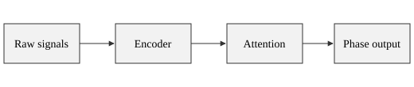
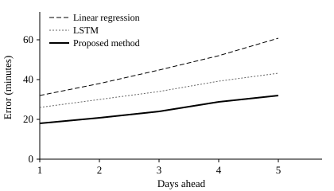
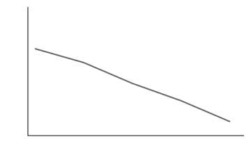
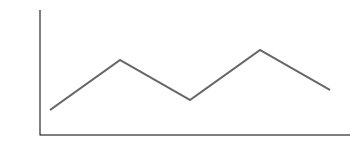

# Introduction {#sec:intro}

The sleep rhythm is one of the most important physiological rhythms in the human body. Disruption affects cognition, mood, and metabolic health[^1]. As wearable devices become common, continuous recording of heart rate, activity, and skin temperature has become practical, which provides a basis for personalized rhythm prediction. Long words such as electroencephalography and internationalization should not break the justified text layout badly. 

The rest of this report is organized as follows. [@sec:method] describes the prediction model, [@sec:experiment] presents the results, and [@sec:conclusion] concludes. The overall framework is shown in [@fig:framework], the core formula is given in [@eq:attention], and the results are listed in [@tbl:result].

[^1]: This is a footnote, used to test the font size and position of footnotes.

## Background

Traditional assessment relies on laboratory melatonin tests, which are expensive and hard to repeat over long periods. Methods based on wearable devices are cheaper, but their data are noisy and vary widely between people.

## Contributions

The main contributions of this work are:

1. an attention model that combines several physiological signals;
2. a masking mechanism for missing data;
3. an evaluation on a simulated dataset.

# Method {#sec:method}

## Overall Framework

The overall framework is shown in [@fig:framework]. The input is preprocessed and encoded, the attention module extracts features, and the model then predicts the phase for the coming week.

{#fig:framework}

## Attention Module

Given a query $Q$, keys $K$, and values $V$, scaled dot-product attention is computed as in [@eq:attention]:

$$
\mathrm{Attention}(Q, K, V) = \mathrm{softmax}\left(\frac{QK^{\top}}{\sqrt{d_k}}\right) V
$$ {#eq:attention}

where $d_k$ is the dimension of the keys. The loss function is defined as:

$$
\mathcal{L} = \frac{1}{N} \sum_{i=1}^{N} \left| \hat{y}_i - y_i \right| + \lambda \left\| \theta \right\|_2^2
$$ {#eq:loss}

To simplify the derivation, here is an intermediate step that does not need a number:

$$
\hat{y} = g(x; \theta)
$$ {-}

### Missing Data

Wearable data often have gaps. We use a mask matrix to mark the missing positions and exclude them when computing [@eq:attention].

### Implementation

The core code is in [@lst:attention]:

```python title="model/attention.py" {#lst:attention}
def attention(q, k, v, mask=None):
    score = q @ k.transpose(-2, -1) / k.size(-1) ** 0.5
    if mask is not None:
        score = score.masked_fill(mask == 0, -1e9)
    return score.softmax(dim=-1) @ v
```

\newpage

# Experiments {#sec:experiment}

## Dataset

The simulated dataset is summarized in [@tbl:dataset].

: Summary of the dataset {#tbl:dataset}

| Split | Subjects | Sampling rate | Duration |
| --- | --- | --- | --- |
| Training | 120 | 1 Hz | 90 days |
| Validation | 30 | 1 Hz | 90 days |
| Test | 50 | 1 Hz | 30 days |

## Comparison

[@tbl:result] lists the prediction error of each method, and [@fig:error] shows the error curves. The proposed method has the lowest error, as defined by [@eq:loss].

| Method | MAE (min) | RMSE (min) | Parameters |
| --- | --- | --- | --- |
| Linear regression | 42.3 | 55.1 | 0.1 K |
| LSTM | 31.7 | 40.2 | 85 K |
| **Proposed** | **24.6** | **31.8** | 120 K |

: Prediction error of each method, where a lower $\mathrm{MAE}$ is better {#tbl:result}

{#fig:error width=80%}

The errors of the four groups are shown in [@fig:weeks], and [@fig:week-c] has the largest variation. A figure group shares one number, and each panel has its own caption.

::: figures {#fig:weeks cols=2}
{#fig:week-a}
{#fig:week-b}
{#fig:week-c}
{#fig:week-d width=80%}

Error of the four groups over time, where group three is shown in [@fig:week-c]
:::

Below is a row of three panels. It has no label, so it cannot be referenced, but it still takes a figure number:

::: figures {cols=3}


Results of the three options
:::

> This is a quotation: simulated data cannot fully represent real conditions, so these conclusions need further validation on real data.

# Conclusion {#sec:conclusion}

We proposed an attention-based method for predicting sleep rhythm shifts. The experiments in [@sec:experiment] show that it outperforms the baselines. Future work includes:

- validation on real data;
- a study of the model's interpretability.

# References

[1] Vaswani A, Shazeer N, Parmar N, et al. Attention is all you need[C]. Advances in Neural Information Processing Systems, 2017.

[2] Smith A. A made-up reference for testing how references look[J]. Journal of Examples, 2026.

# Acknowledgements

Thanks to everyone who helped test this template. Like "References", this chapter is not numbered.

# Appendix: - Survey Details {#sec:app-survey}

Appendices are lettered. See [@sec:app-questions], [@tbl:app-items], [@fig:app-panel], and [@eq:app-score] below.

## Questions {#sec:app-questions}

: Survey items {#tbl:app-items}

| Item | Scale |
| --- | --- |
| Sleep quality | 1 to 5 |
| Daytime fatigue | 1 to 5 |

### Scoring

The score is computed as follows:

$$
S = \sum_{i=1}^{n} w_i x_i
$$ {#eq:app-score}

{#fig:app-panel width=50%}

#### Weights

This heading should be A.1.1.1. The scoring code is in [@lst:app-score]:

```python title="score.py" {#lst:app-score}
def score(weights, items):
    return sum(w * x for w, x in zip(weights, items))
```

## Notes

This heading should be A.2.

# Appendix {#sec:app-raw}

The second appendix should be B, and its numbering starts again. See [@fig:app-group], [@fig:app-group-a], and [@sec:app-raw].

## Raw Data

::: figures {#fig:app-group cols=2}
{#fig:app-group-a}


A figure group in the second appendix
:::

A wrong reference should stand out: [@fig:missing].

# Appendix

``` python
#!/usr/bin/env python3
"""本地 Markdown 编辑器，可以打开任意文件夹。

用法：bash start.sh [文件夹]，或 python editor.py [端口]，然后打开 http://localhost:8001

只监听本机，并拒绝来自其他网页的请求，否则你打开的任意网站都可能改写你的文件。
要打开哪个文件夹由每个请求的 root 参数决定，服务端不保存“当前文件夹”，所以多个窗口可以各开一个文件夹。
"""
import base64
import json
import mimetypes
import os
import posixpath
import re
import shutil
import subprocess
import sys
import tempfile
import threading
from datetime import datetime
from http.server import BaseHTTPRequestHandler, ThreadingHTTPServer
from pathlib import Path
from urllib.parse import parse_qs, quote, unquote, urlsplit

import yaml
from markdown_it import MarkdownIt
from mdit_py_plugins.anchors import anchors_plugin
from mdit_py_plugins.dollarmath import dollarmath_plugin
from mdit_py_plugins.footnote import footnote_plugin
from mdit_py_plugins.tasklists import tasklists_plugin
from pygments import highlight as pygments_highlight
from pygments.formatters import HtmlFormatter
from pygments.lexers import get_lexer_by_name
from pygments.util import ClassNotFound

import academic
import report_style

try:
    from send2trash import TrashPermissionError, send2trash
except ImportError:  # 只有删除文件需要它，没装时其他功能照常可用
    send2trash = None
    TrashPermissionError = OSError

DEFAULT_PORT = 8001
APP_DIR = Path(__file__).resolve().parent
STATIC_DIR = APP_DIR / "static"
RECENT_FILE = APP_DIR / "recent.json"
PREFERENCES_FILE = APP_DIR / "preferences.json"
STATIC_FILES = {
    "/": ("index.html", "text/html; charset=utf-8"),
    "/editor.js": ("editor.js", "text/javascript; charset=utf-8"),
    "/editor.css": ("editor.css", "text/css; charset=utf-8"),
    "/document.css": ("document.css", "text/css; charset=utf-8"),
}
MARKDOWN_SUFFIXES = (".md", ".markdown")
SKIP_DIRS = {"node_modules", "__pycache__", "venv"}  # 依赖和缓存，里面的 Markdown 不是你写的
MAX_TREE_ENTRIES = 50000  # 不小心打开整个硬盘时，不至于一直卡住
MAX_RECENT = 8
IMAGE_TYPES = {"image/png": ".png", "image/jpeg": ".jpg", "image/gif": ".gif", "image/webp": ".webp"}
MAX_IMAGE_BYTES = 50 * 1024 * 1024
CODE_CSS = HtmlFormatter(style="default").get_style_defs("pre")
CDN_CODEMIRROR = "https://cdn.jsdelivr.net/npm/codemirror@5.65.16/"
CDN_KATEX = "https://cdn.jsdelivr.net/npm/katex@0.16.11/"
# 第二道防线：就算清理漏了，也不能运行内联脚本，脚本只能来自这些地址，也不能向其他网站发请求
PAGE_SECURITY_POLICY = (
    "default-src 'none'; "
    f"script-src 'self' {CDN_CODEMIRROR} {CDN_KATEX}; "
    f"style-src 'self' 'unsafe-inline' {CDN_CODEMIRROR} {CDN_KATEX}; "
    f"font-src {CDN_KATEX} data:; "
    "img-src * data: blob:; connect-src 'self'; frame-src https:; "
    "base-uri 'none'; form-action 'none'; object-src 'none'"
)
FILE_SECURITY_POLICY = "default-src 'none'; style-src 'unsafe-inline'; sandbox"  # 直接打开 SVG 时，里面的脚本不能运行

recent_lock = threading.Lock()


class ApiError(Exception):
    def __init__(self, status, message):
        super().__init__(message)
        self.status = status
        self.message = message


# ---------- 路径 ----------
def workspace(root):
    """用户打开的文件夹，必须是绝对路径。"""
    path = Path(root) if isinstance(root, str) and root else None
    if path is None or not path.is_absolute():
        raise ApiError(400, "Enter the full path of a folder")
    if not path.is_dir():
        raise ApiError(404, f"Folder not found: {root}")
    return path.resolve()


def content_path(root, rel):
    """把相对路径转成文件路径，不允许离开打开的文件夹，也不允许碰 .git 这样的隐藏文件。"""
    base = workspace(root)
    parts = rel.split("/") if isinstance(rel, str) else []
    invalid = not parts or "\\" in rel or ":" in rel or any(
        not part or part.startswith(".") or part.endswith((" ", ".")) for part in parts
    )

```
