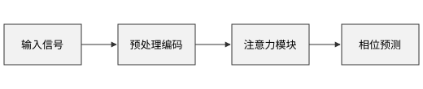

# 引言 {#sec:intro}

这里写的 `style` 比模板文件优先，所以这份报告的一级标题是居中的，其他样式和模板一样。如[@fig:arch]所示，详见[@sec:method]。

{#fig:arch width=60%}

# 方法 {#sec:method}

## 数据

: 实验结果 {#tbl:result}

| 方法 | 误差 |
| --- | --- |
| A | 1.2 |
| B | 0.8 |

结果见[@tbl:result]。
