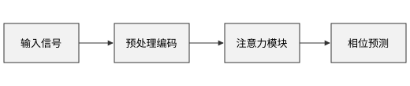
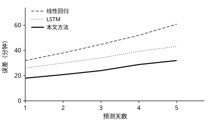

这个文件是一个模板，别的文件写 `template: ./template.md` 就能用它的样式，例子见 `report_using_template.md`。模板的正文不会进入那些文件，这里的内容只用来预览效果。

# 绪论 {#sec:intro}

正文是楷体小四，固定行距 20 磅，一级标题靠左，并且写成“第一章”。如[@fig:sample]所示，结果见[@tbl:sample]，公式见[@eq:sample]，代码见[@lst:sample]，这一章是[@sec:intro]。

{#fig:sample width=60%}

## 二级标题

: 不是三线表，每个格子都有边框 {#tbl:sample}

| 方法 | 误差 |
| --- | --- |
| A | 1.2 |
| B | 0.8 |

$$
E = mc^2
$$ {#eq:sample}

### 三级标题

三级标题用了另一种字体。

```python title="hello.py" {#lst:sample}
print("hello")
```

# 第二部分

第二章的编号也要跟着变：

{width=50%}

# 附录：补充材料

称呼换成了“附件”：

{width=30%}
